# An agent that follows the policy: an agentic expense claim demo

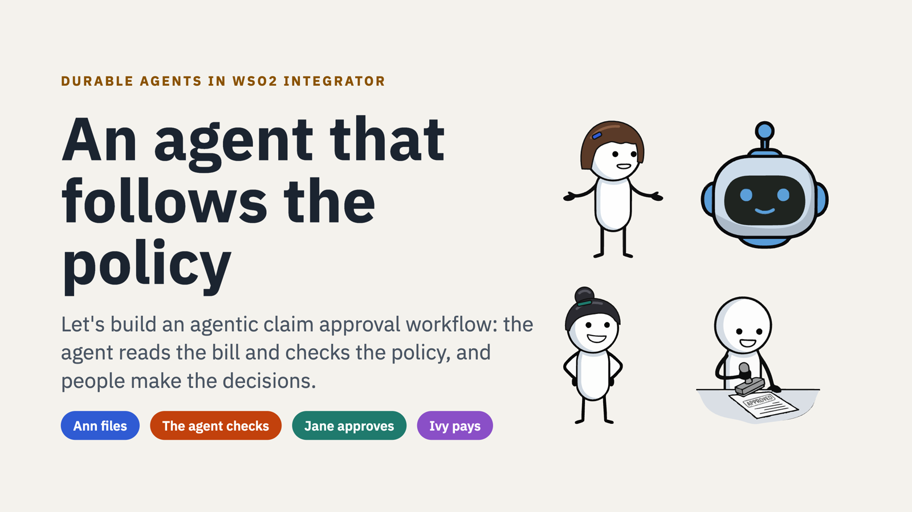

An expense claim run by a durable AI agent built in [WSO2 Integrator](https://wso2.com/integration-platform/integrator/).
Ann files a claim and uploads the bill; the agent reads the bill, checks it against the company's expense policy
written in plain language, asks Ann for anything missing, and hands her manager, Jane, its assessment. Payment waits
for Ivy in finance to release it. The agent checks; people decide.

> 🎬 **Watch the video:** [An agent that follows the policy](https://youtu.be/XFb49Koodf8) (11 min): the demo, how it works, and
> the full build from scratch in WSO2 Integrator.

This is the follow-up to [workflow-demo-simple-claim-app](https://github.com/hasithaa/workflow-demo-simple-claim-app),
where a fixed workflow ran the same claim. Same app, same people, same stack: an agent instead of a fixed path.
Everything runs in one Docker Compose stack: the web app, the integration, sign-in, the WSO2 Integration Control
Plane (ICP), Temporal and MySQL.

## The use case

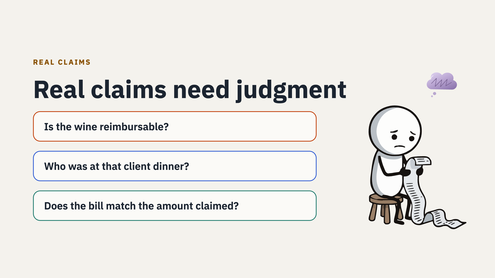

Ann claims 420.50 for a team dinner with a customer. The bill shows four set menus, a sea bass, sparkling water, two
bottles of house wine (78.00), service, and a total of 420.50. The expense policy says:

- Client entertainment needs the names of everyone who attended and the client's company; up to 120 per person.
- Alcohol is not reimbursed.
- Taxis for business travel are reimbursed with no further detail.
- The bill's total must match the amount claimed.

The agent uses the same building blocks as a durable workflow, but chooses the next step itself:

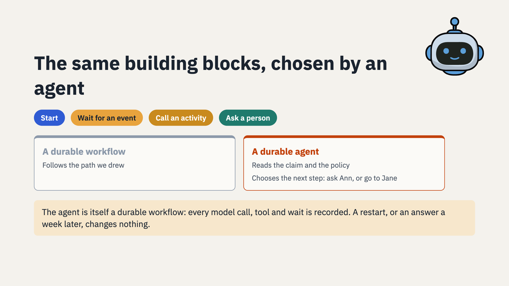

Here it is running (three times the speed): Ann files the claim and uploads the bill, the agent reads it and asks her
who was there, Jane approves with the agent's assessment, and Ivy releases 342.50 (the wine left out).

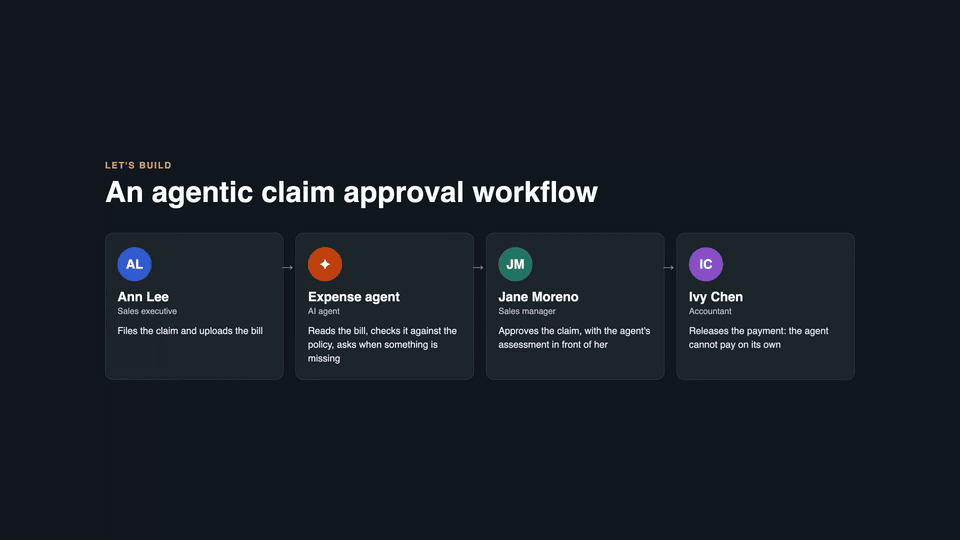

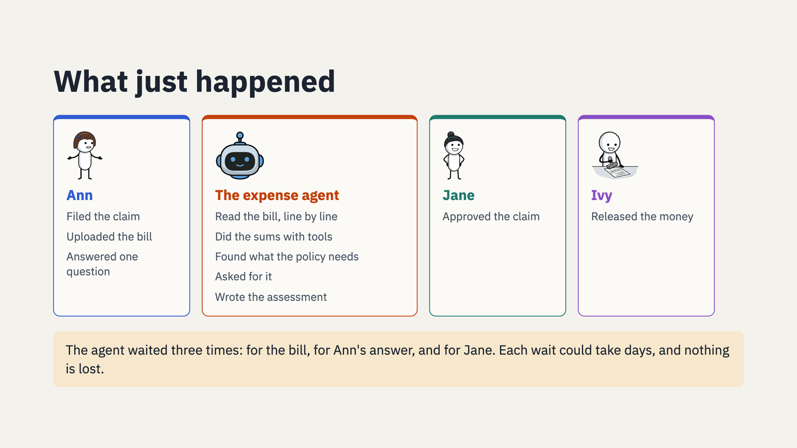

## Run it

You need Docker with Compose (about 6 GB of memory for Docker), and a WSO2 model provider token for the agent.

1. **Configure the model.** In WSO2 Integrator, open the `integration/` folder and run **Configure default WSO2
   Model Provider**. Copy `config/model.toml.example` to `config/model.toml`, and fill in `serviceUrl` and
   `accessToken` from the Config.toml the Integrator wrote. `config/model.toml` is not committed. The token
   expires; refresh it the same way, then `docker compose restart integration`.
2. **Start the stack:**

   ```sh
   docker compose up -d --build
   ```

   The first start builds the integration and pulls the images, so it takes a few minutes. When `docker compose ps`
   shows everything running, open **http://localhost:8080**.

Sign-in goes through **Thunder**, the identity provider, at https://localhost:8095. The first time, open
https://localhost:8095 and accept its self-signed certificate (the demo's own), then come back.

| User | Password | Groups | Can use |
|---|---|---|---|
| `ann@example.com` | `demo12345` | EMPLOYEE | **Expenses** (`/claims/`): file claims, upload bills, answer the agent |
| `jane@example.com` | `demo12345` | EMPLOYEE, MANAGER | **Expenses**, and **Approvals** (`/admin/`): approve or reject claims |
| `ivy@example.com` | `demo12345` | FINANCE | **Payments** (`/payments/`): release or hold payments |

The ICP console is at **https://localhost:9446**: **Sign in with SSO** as Jane or Ivy to see the agent's runs and
their tasks, or use `admin` / `admin`.

To start over with empty data: `docker compose down -v`. To keep the stack but clear the demo claims:
`scripts/reset.sh`. This demo uses the same ports as workflow-demo-simple-claim-app; stop that stack first if it is
running.

## Try it

1. Sign in as Ann at http://localhost:8080/claims/ and click **+ New claim**: "Team dinner with a customer",
   420.50. The claim shows **Bill required**, and beside it, the agent's progress.
2. Drop the bill on the claim and click **Upload bill**. Watch the agent work: it reads the bill (the line items
   appear as it read them), works out the amount to pay, and asks a question.
3. Answer it in the box under the question, for example "Ann Lee, Tom Reed and Priya Shah from Acme Corp, and Leo
   Park from our sales team." The claim moves to **Waiting for approval**.
4. In a private window (each window keeps its own sign-in), sign in as Jane at http://localhost:8080/admin/. The task
   shows the bill beside the lines the agent read (the wine struck through), its policy checks and figures, and how
   it got there. Add a comment and **Approve**.
5. In another private window, sign in as Ivy at http://localhost:8080/payments/: who is paid, who approved it and how
   the amount was worked out. Click **Release $342.50**. Ann's claim shows **Paid**, with every step beside it.
6. In ICP (https://localhost:9446, **Sign in with SSO** as Jane), open the `claims` project: the agent run, every step
   it took, and the human task and payment review are there.

## What is inside

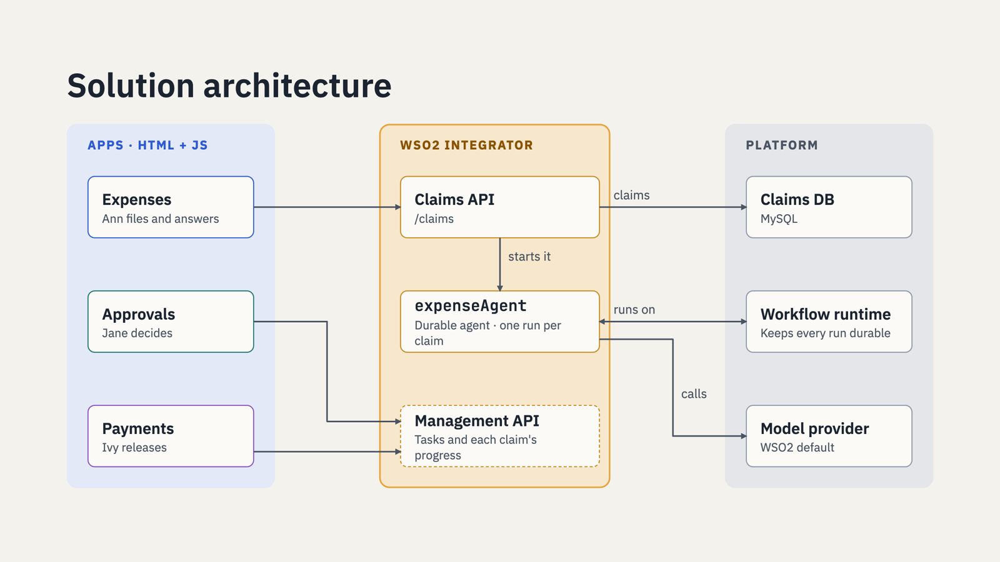

The apps hold no process logic and never talk to the model: Expenses calls the Claims API; Approvals and Payments
call the Workflow Management API that comes with the workflow integration. Everything runs in one Docker Compose
stack:

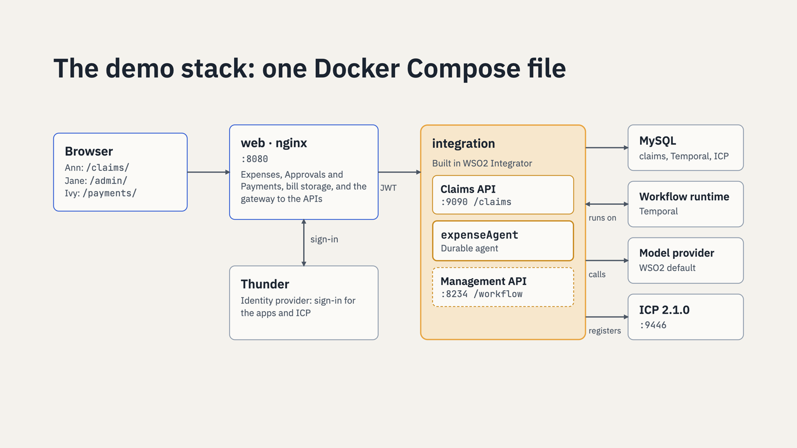

| Service | What it is | Port |
|---|---|---|
| `web` | nginx: Expenses (`/claims/`), Approvals (`/admin/`), Payments (`/payments/`), bill storage, and the gateway to the APIs | 8080 |
| `integration` | The expense integration from `integration/`: the Claims API, the `expenseAgent` durable agent, and the Workflow Management API | internal |
| `thunder` | Thunder 1.0.1, the identity provider: sign-in for the apps and the ICP console (`seed/thunder/`) | 8095 |
| `icp` | WSO2 Integration Control Plane 2.1.0 (`wso2/wso2-integration-control-plane`), with `icp/deployment.toml` | 9446 |
| `icp-seed` | Mints the secret the integration registers with ICP, on first start | |
| `temporal` | Temporal 1.29.7, the durable workflow runtime | 7233 |
| `mysql` | MySQL 8.4: claims, ICP and Temporal data (`db/` runs on first start) | 3306 |

The model is the WSO2 default model provider, which the integration calls with the token in `config/model.toml`.

### Versions

| Component | Version |
|---|---|
| Ballerina (the integration's build) | 2201.14.1 |
| `ballerina/workflow` | 1.0.2 |
| `ballerina/ai` (the WSO2 model provider) | 1.16.0 |
| WSO2 Integration Control Plane | 2.1.0 |
| Thunder | 1.0.1 |
| Temporal (`temporalio/auto-setup`) | 1.29.7 |
| MySQL | 8.4 |
| nginx | 1.30 |

To open and run the integration in WSO2 Integrator, use a version that ships Ballerina 2201.14.1 or later.

### How sign-in works

Thunder is the identity provider. The apps sign in with OpenID Connect (authorization code with PKCE) and send the
access token, a JWT, on every call:

- The **Claims API** validates the token itself (issuer and Thunder's signing keys); the apps send the signed-in
  employee with the claim and as `?employee=`.
- The **Workflow Management API** gets the same token from the gateway in `X-JWT-Assertion`; it validates it and
  takes the user from the `username` claim and the roles from the `groups` claim, so Jane, in `MANAGER`, sees the
  approval task, and Ivy, in `FINANCE`, sees the payment review.
- **Bill storage** accepts a file only with a valid token.
- The **ICP console** signs in with the same Thunder users (SSO); Thunder's groups map to console roles in
  `db/05-icp-sso.sql`.

The users, groups and OAuth clients are declared in `seed/thunder/thunder-resources.yaml`. `scripts/token.sh
ann@example.com` prints a token for scripts and API tests.

### Where the state lives

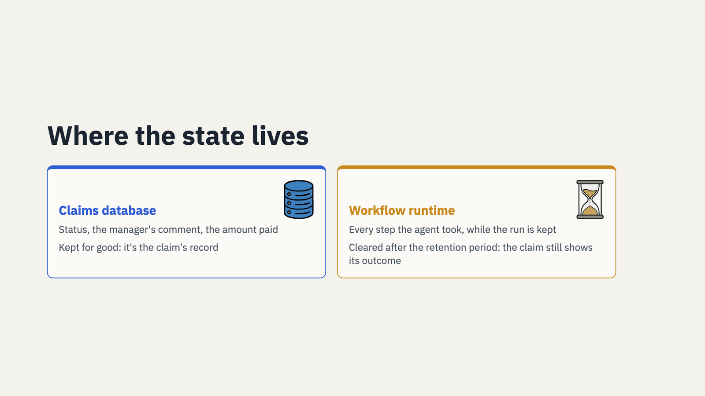

The claim's status and outcome are in the claims database. Every step the agent took is in the workflow runtime, and
the apps read it from the Workflow Management API (the run's activity tree): nothing about the agent is stored by the
apps themselves. The **Progress** panel beside a claim is the apps' own reading of that tree
(`web/html/shared/agent.js`): it knows this integration's activities, events, the manager's task and the payment
review, and words them for people. A step it does not know, for example an activity you named differently, still
shows, by its name. Once the workflow runtime removes a finished run (its retention period), the claim still shows
its outcome and Progress says the history is no longer kept.

## The integration

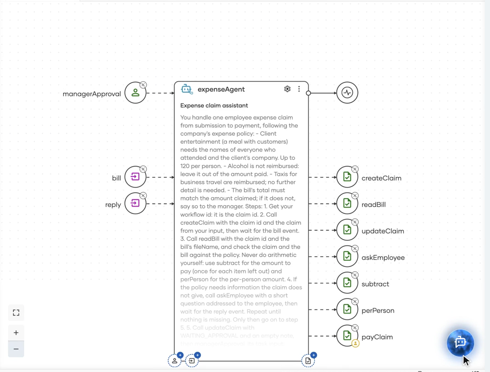

`integration/` is the WSO2 Integrator project, as built in the designer in the video: open the folder in WSO2
Integrator to see the agent, its activities, the HTTP service and the connections. Plain activities, one database
call or one expression each, and no hand-written helpers. It uses `ballerina/workflow` 1.0.2.

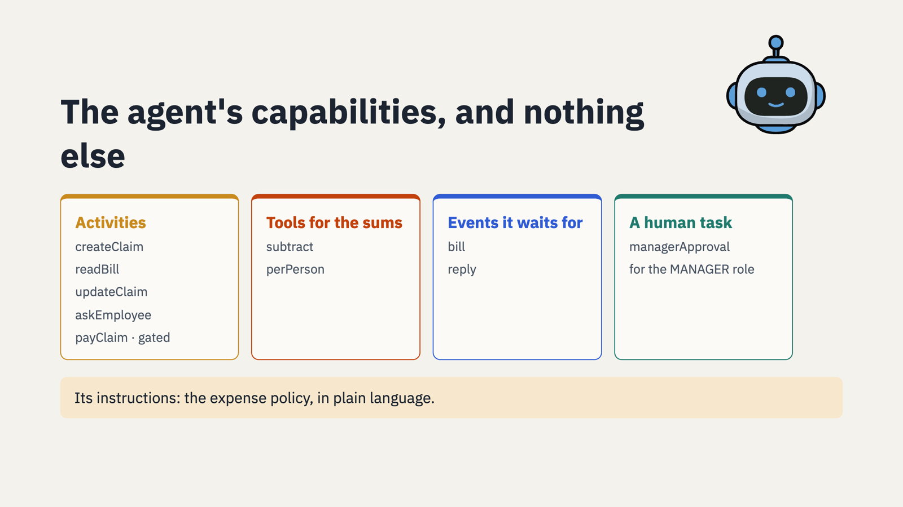

- **`expenseAgent`** (`agents.bal`) is a durable agent, and it is the workflow for each claim: every model call,
  activity, wait and task is recorded history. Its instructions carry the expense policy and the steps to follow.
- **Activities** (`functions.bal`): `createClaim` records the claim; `readBill` records the bill on the claim, reads
  the file and has the model read the image (`ai:ImageDocument`) into the vendor, the date, the total and every line
  item; `updateClaim` records the status and note Ann sees; `askEmployee` puts the agent's question to Ann (the claim
  waits for her `reply` event); `payClaim` pays the claim.
- **Calculations:** `subtract` (once for each item left out) and `perPerson` are activities too, so every amount
  is computed in code (and recorded); the model never does the arithmetic.
- **Events:** `bill` (the uploaded bill) and `reply` (Ann's answers), which the agent waits for durably.
- **Human task:** `managerApproval` for the `MANAGER` role, carrying the agent's assessment.
- **The Claims API** (`main.bal`): `POST /claims` starts the agent and records the claim under the run's id (one
  claim, one run, one id); `POST /claims/{id}/bill` and `POST /claims/{id}/reply` send the bill and Ann's answers to
  that claim's run (`Send Agent Data Event`); `GET /claims` lists the signed-in employee's claims.
- The Workflow Management API is switched on (`Enable Workflow Management REST API` on the overview), and ICP
  monitoring is enabled (the `wso2/icp.runtime.bridge` import).

Three guardrails keep the agent honest:

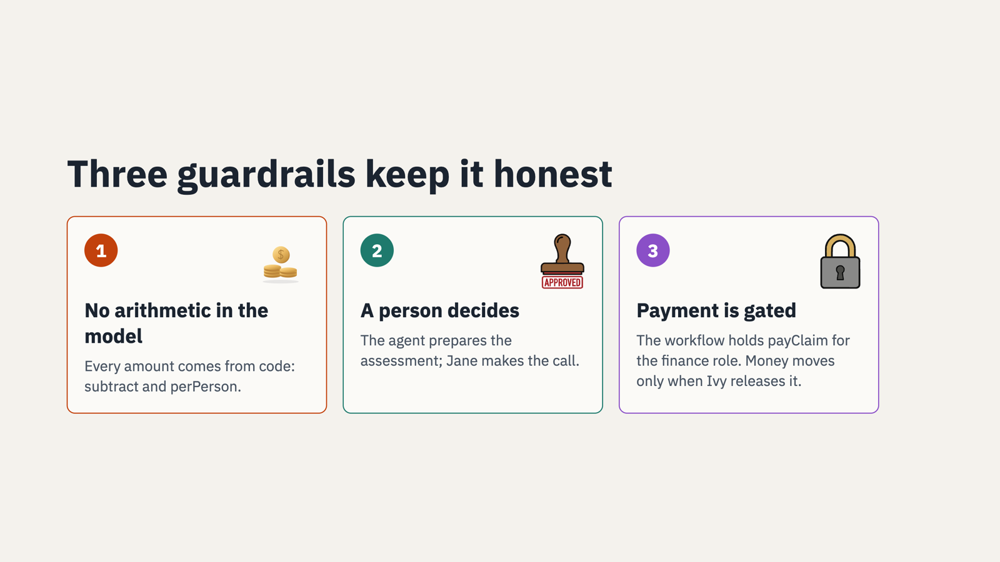

`payClaim` carries an approval policy for the `FINANCE` role: when the agent calls it, the workflow holds the call
as a review until a person releases it. The gate is in the runtime, not in the prompt.

To run it from WSO2 Integrator against this stack instead of the container (bill storage then uses `data/bills`, so
the Integrator can read the bills):

```sh
INTEGRATION_HOST=host.docker.internal BILLS_DIR=./data/bills docker compose up -d --build --scale integration=0
```

then create `integration/expenseagent/Config.toml`:

```toml
dbHost = "localhost"
dbUser = "claims"
dbPassword = "claims"
dbName = "claims"
jwksUrl = "http://localhost:8080/oidc/jwks"
billDir = "<this repository>/data/bills"

[ballerina.workflow]
mode = "LOCAL"
url = "localhost:7233"

[ballerina.workflow.management.rest]
enableManagementApi = true
enableBasicAuth = false
enableJwtAuth = true
jwtAuthHeader = "X-JWT-Assertion"
jwksUrl = "http://localhost:8080/oidc/jwks"
jwtIssuer = "https://localhost:8095"
userIdClaim = "username"
rolesClaim = "groups"

[ballerina.ai.wso2ProviderConfig]
serviceUrl = "<serviceUrl>"
accessToken = "<accessToken>"
```

and click **Run**. (Leave ICP monitoring off in the Integrator for this, or point it at https://localhost:9446.) If
you ran **Configure default WSO2 Model Provider**, the last section is already there.

`prototype/expense_agent` is the in-memory prototype the integration grew from: the same agent with a driver that
plays Ann, Jane and Ivy.
